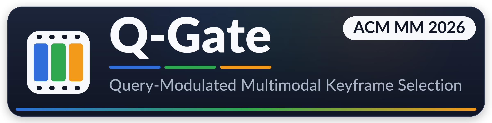
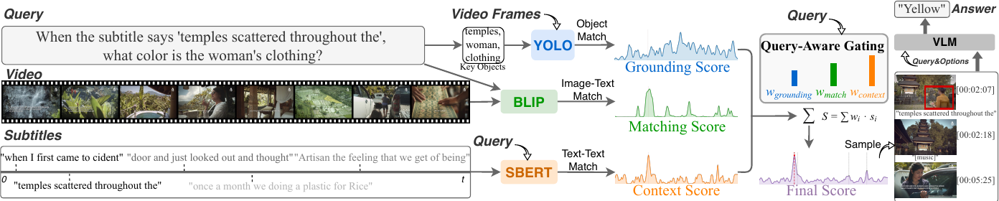

<div align="center">



### Where to Focus: Query-Modulated Multimodal Keyframe Selection for Long Video Understanding

**Shaoguang Wang · Weiyu Guo · Ziyang Chen · Xuming Hu · Hui Xiong**
<br>
<sub>The Hong Kong University of Science and Technology (Guangzhou)</sub>

[](https://dl.acm.org/doi/10.1145/3767308.3835040)
[](https://arxiv.org/abs/2604.17422)
[](https://2026.acmmm.org/)
[](https://shaoguangwang.github.io/qgate/)
[](https://github.com/shaoguangwang/Q_Gate/actions/workflows/ci.yml)
[](LICENSE)
[](https://www.python.org/)

*Keyframe selection as **per-question modality routing** — an LLM decides where each query should look.*

<br>



<sub><em>Three parallel expert streams are dynamically fused by a query-aware gate; the top-K timestamped frames and subtitles pass to a downstream MLLM.</em></sub>

</div>

## ✨ Highlights

- 🧩 **Training-free** — off-the-shelf experts, no fine-tuning.
- 🎛️ **Query-modulated** — an LLM weights three experts per question.
- 🔀 **Look *and* listen** — dynamically fuses visual and subtitle cues.
- 📈 **State-of-the-art** — up to **+6.4** on Video-MME Long, across backbones.

## 🧠 Method

The three expert streams, their paper names, and the off-the-shelf model behind each:

| Code name | Paper name | Expert model | Gating weight |
|---|---|---|---|
| `score_logic` | Visual Grounding | YOLO-World | `w_logic` |
| `score_relevance` | Global Matching | BLIP (image-text matching) | `w_relevance` |
| `score_narrative` | Contextual Alignment | Sentence-BERT (`all-mpnet-base-v2`) | `w_narrative` |

<details>
<summary>How the gate works (4 steps)</summary>

1. An LLM (GPT-4o by default) reads the query and emits a weight triple `[w_logic, w_relevance, w_narrative]` that sums to 1.
2. Each stream is normalized with a unified Min-Max + masked temperature Softmax pipeline (τ = 0.5).
3. The streams are fused into a single `score_fusion` distribution, and its top-K seconds become keyframes.
4. Each selected frame is anchored with its `[Image at H:MM:SS]` timestamp and (optionally) subtitles, then passed to a downstream MLLM.

</details>

## ⚡ Quick start

**Offline demo** — no videos, models, or API key required. Fuses two sample records (all three streams pre-filled) with the static `equal` strategy, to confirm the code runs and show the input schema:

```bash
pip install "numpy<2" tqdm
python fuse_scores.py --input_json Data/demo_raw_scores.json \
    --output_dir ./demo_out --strategy equal --temperature 0.5
# -> ./demo_out/demo_raw_scores_fusion_equal_T0.5.json (adds a score_fusion field)
```

`Data/demo_raw_scores.json` documents, by example, the `score_logic` / `score_relevance` / `score_narrative` arrays each Stage-1 producer must attach per record.

**Full run** — once `.env`, `Datasets/`, and the Stage-1 score streams are ready, `run_example.sh` runs Stage 2 → Stage 3 on LongVideoBench with GPT-4o (K = 8):

```bash
bash run_example.sh
# override any knob: DATASET=videomme BACKEND=qwen3_32b K=32 bash run_example.sh
```

The four stages — `prepare_data.py` (Stage 0) → score producers (Stage 1) → `fuse_scores.py` (Stage 2) → `run_qa.py` (Stage 3) — are detailed below.

## 🔧 Installation

```bash
conda create -n qgate python=3.12 -y
conda activate qgate
pip install -r requirements.txt
```

> **NumPy must stay `< 2.0`** — NumPy 2.x breaks the OpenCV imports used here.

The Stage-1 producers have heavier, conflicting dependencies — keep each in **its own** environment, not the main `qgate` one (they communicate only through per-record JSON files).

<details>
<summary>Producer environments (BLIP · YOLO-World)</summary>

- **Relevance (BLIP)** uses [LAVIS](https://github.com/salesforce/LAVIS), which pins older `tokenizers`/`transformers`/`timm` builds that do **not** install on Python 3.12 (the `tokenizers` wheel needs a Rust toolchain there) and would downgrade the fusion/QA packages. Use a **separate Python 3.9 environment**:
  ```bash
  conda create -n qgate-relevance python=3.9 -y
  conda activate qgate-relevance
  pip install salesforce-lavis
  ```
  Run `calculate_relevance_score.py` from this env; run everything else from `qgate`.
- **Grounding (`score_logic`)** needs the external [YOLO-World](https://github.com/AILab-CVC/YOLO-World) repo plus `mmdet`/`mmengine`/`supervision`/`decord`/`seaborn`/`datasets` and a checkpoint, in its own env for a matched `mmcv` build. Clone YOLO-World into `score_producers/grounding/YOLO-World/` (git-ignored).

</details>

<details>
<summary>Development (lint &amp; tests)</summary>

The CI (`.github/workflows/ci.yml`) lints with `ruff` (pyflakes errors), byte-compiles every source, runs the unit tests, and executes the offline demo. To reproduce locally:

```bash
pip install -e ".[dev]"          # pytest + ruff
ruff check --select F qgate fuse_scores.py run_qa.py prepare_data.py score_producers tests
pytest tests/ -q                 # covers the fusion normalization + keyframe selection primitives
```

</details>

## 🔑 Configuration

```bash
cp .env.example .env
```

- **`OPENAI_API_KEY`** — required for the GPT-4o gater, the GPT-4o QA backend, **and** the grounding producer's entity extraction (Stage 1, `score_logic`).
- **`OPENAI_BASE_URL`** — must be the **full chat-completions endpoint** (the code POSTs to it directly). Default `https://api.openai.com/v1/chat/completions`; for a proxy give the complete URL, e.g. `https://your-proxy/v1/chat/completions` — **not** `https://your-proxy/v1`.

> Scripts read credentials from the environment and do **not** auto-load `.env` — before a manual run, `set -a; . ./.env; set +a`. `run_example.sh` sources `.env` for you.

<details>
<summary>Local open-source backends (Qwen / InternVL via vLLM)</summary>

Serve any OpenAI-compatible server (e.g. vLLM) and point the matching env var at it:

- `QWEN3_32B_BASE_URL` → backend `qwen3_32b`
- `INTERNVL3_BASE_URL` → backend `internvl3_8b`
- `INTERNVL26B_BASE_URL` → backend `internvl_26b`

</details>

## 📦 Data preparation (Stage 0)

Every stage reads a **unified QA-index JSON**. `Data/` ships one sample record per benchmark (`longvideobench` / `videomme`) documenting the format; the full indices are built with `prepare_data.py`:

```bash
# LongVideoBench — official validation JSON + local videos
python prepare_data.py --dataset longvideobench \
    --input_file /path/to/lvb_val.json \
    --video_root ./Datasets/LVBench/videos --output_dir ./Data

# Video-MME — question metadata from HuggingFace hub (needs `pip install datasets`); videos local
python prepare_data.py --dataset videomme \
    --video_root ./Datasets/Video-MME/videos --output_dir ./Data
```

Subtitle roots are overridable via `LVB_SUBTITLE_ROOT` / `VIDEOMME_SUBTITLE_ROOT`. Note the layout: LongVideoBench uses `subtitles/<id>_en.json` and **Video-MME uses a single `subtitle/<id>.srt`**.

<details>
<summary>Dataset layout &amp; record schema</summary>

```text
Datasets/
├── LVBench/
│   ├── videos/                <video_id>.mp4
│   └── subtitles/             <video_id>_en.json          # LongVideoBench subtitle format
└── Video-MME/
    ├── videos/                <video_id>.mp4
    └── subtitle/              <video_id>.srt
```

| Field | Type | Notes |
|---|---|---|
| `video_id` | str | unique clip id |
| `video_path` | str | path to the `.mp4` (rooted at `--video_root`) |
| `question` | str | the question text |
| `options` | str | newline-joined, letter-prefixed: `"A) ...\nB) ...\n..."` |
| `answer` | str | correct option letter, e.g. `"B"` |
| `duration_group` | str / int | length bucket — LVB uses seconds (`15/60/600/3600`); Video-MME uses `short/medium/long` |
| `position` | list | optional ground-truth timestamp hints (may be empty) |

</details>

## 🎯 Score streams (Stage 1)

Compute the three streams **in dependency order** — `score_logic` → `score_relevance` → `score_narrative`. The `score_relevance` and `score_narrative` producers each read the previous JSON via `--input_json` and write an auto-suffixed file (e.g. `*_blip_relevance.json`, `*_all-mpnet-base-v2_narrative.json`) that you pass to the next stage; the `score_logic` (grounding) scripts take `--obj_path`/`--kfs_path` instead (see below).

| Stream | Producer | Reproducible? |
|---|---|---|
| `score_logic` (Visual Grounding) | `score_producers/grounding/` | ⚠️ external YOLO-World repo + checkpoint + `mmdet`/`mmengine`/`supervision`/`datasets` |
| `score_relevance` (Global Matching) | `score_producers/relevance_blip/` | ✅ once LAVIS is installed (Python 3.9 env) |
| `score_narrative` (Contextual Alignment) | `score_producers/narrative_sbert/` | ✅ in-repo (LVB / Video-MME only) |

> **Field handoff:** the grounding keyframe script writes raw scores as `score_list`, but fusion reads `score_logic`. Before the relevance step, merge each record's `score_list` into a `score_logic` field on `Data/<dataset>_processed.json` and feed that merged file onward.

<details>
<summary>Per-producer commands</summary>

**1. `score_logic` (Visual Grounding).** Run from inside the producer dir so its local `lib/`/`utils/` imports resolve; it re-loads the raw benchmark annotations itself. **Requires `OPENAI_API_KEY`** — Step 1 uses GPT-4o to extract the query's key objects, and the script exits immediately without it.

```bash
cd score_producers/grounding
export OPENAI_API_KEY=...   # or: set -a; . ../../.env; set +a
# Step 1 — propose grounding objects per question
python scripts/get_grounding_objects.py --dataset longvideobench \
    --video_root /path/to/LVBench/videos \
    --anno_path /path/to/LVBench/lvb_val.json --obj_path ./output/lvb_obj.json
# Step 2 — YOLO-World keyframe search -> per-second raw grounding scores
python scripts/get_key_frames.py \
    --obj_path ./output/lvb_obj.json --kfs_path ./output/lvb_logic.json
```

The `--config_path`/`--checkpoint_path`/`--video_root`/`--anno_path` defaults assume the external YOLO-World layout; repoint them at your local paths.

**2. `score_relevance` (BLIP image-text matching).** Run from the dedicated `qgate-relevance` (Python 3.9) env (see [Installation](#-installation)). `--model_name blip` loads the LAVIS `blip_image_text_matching` model (ViT-L); the score is its ITM probability.

```bash
conda activate qgate-relevance
# <merged.json> carries score_logic (see the Field handoff note above), not the raw score_list.
python score_producers/relevance_blip/calculate_relevance_score.py \
    --input_json <merged.json> --output_dir ./Score/relevance \
    --dataset longvideobench --model_name blip
```

**3. `score_narrative` (Sentence-BERT).** Accepts `--dataset longvideobench|videomme`; its output carries all three streams and is the input to Stage 2.

```bash
python score_producers/narrative_sbert/calculate_narrative_score.py \
    --input_json <relevance_scores.json> --output_dir ./Score/narrative \
    --dataset longvideobench
```

</details>

## 🚀 Fusion & QA (Stages 2–3)

`run_example.sh` (see [Quick start](#-quick-start)) reads `./Score/<dataset>_raw_scores.json` — the **Stage-1 output** (the narrative producer's file already carries all three streams), which the script does not create. Point `RAW_SCORES` at that file, or copy it into place:

```bash
cp ./Score/narrative/<dataset>_processed_blip_relevance_all-mpnet-base-v2_narrative.json \
   ./Score/<dataset>_raw_scores.json
```

To run the stages manually, given an input JSON with all three raw streams:

```bash
# Stage 2 — query-modulated gating + fusion (GPT-4o gater, τ = 0.5)
python fuse_scores.py \
    --input_json <narrative_scores.json> \
    --output_dir ./Score/fusion \
    --strategy llm --backend gpt4 --temperature 0.5

# Stage 3 — keyframe selection + downstream QA (LongVideoBench, GPT-4o, K = 8)
python run_qa.py \
    --input_json <fused_scores.json> \
    --dataset longvideobench --output_dir ./results \
    --backend gpt4 --frame_num 8 \
    --score_key score_fusion \
    --use_subtitles --filter_with_subtitles
```

<details>
<summary>Flags &amp; ablations</summary>

- **Gating** (`fuse_scores.py --strategy`, required): `llm` (the paper's Query-Modulated Gating) or `equal` (static 1/3 weights, used by the offline demo). The LLM gater sees the candidate options, the paper's main setting.
- **Backends** (`--backend`): `gpt4`, `qwen3_32b`, `internvl3_8b`, `internvl_26b` — see [Configuration](#-configuration).

</details>

## 🏆 Results

Q-Gate downstream-QA accuracy (%) on LongVideoBench and Video-MME (paper, Table 1), across MLLM backbones and video-length splits.

| Backbone | K | LVB Long | LVB Med | LVB Short | MME Long | MME Med | MME Short |
|:---:|:---:|:---:|:---:|:---:|:---:|:---:|:---:|
| GPT-4o | 8 | 50.71 | 56.55 | 65.41 | 54.78 | 59.68 | 67.16 |
| Qwen3-VL | 32 | 59.40 | 63.11 | 70.59 | 61.19 | 66.13 | 79.41 |

<sub>Downstream-QA accuracy (%); higher is better. K = number of selected keyframes. The Qwen3-VL backbone (Qwen3-VL-32B-Instruct) is selected with `--backend qwen3_32b`.</sub>

See the paper for the full comparison against prior methods, ablations, and efficiency analysis.

## 📝 Citation

```bibtex
@inproceedings{10.1145/3767308.3835040,
  author = {Wang, Shaoguang and Guo, Weiyu and Chen, Ziyang and Hu, Xuming and Xiong, Hui},
  title = {Where to Focus: Query-Modulated Multimodal Keyframe Selection for Long Video Understanding},
  year = {2026},
  isbn = {9798400722134},
  publisher = {Association for Computing Machinery},
  address = {New York, NY, USA},
  url = {https://doi.org/10.1145/3767308.3835040},
  doi = {10.1145/3767308.3835040},
  booktitle = {Proceedings of the 34th ACM International Conference on Multimedia},
  pages = {10508--10517},
  numpages = {10},
  keywords = {long video understanding, keyframe selection, multimodal fusion, visual grounding, video question answering},
  location = {Rio de Janeiro, Brazil},
  series = {MM '26}
}
```

> Official proceedings version: [ACM Digital Library](https://dl.acm.org/doi/10.1145/3767308.3835040), MM '26, pp. 10508–10517.

## 📚 Acknowledgements

Q-Gate builds on excellent open-source work, including [YOLO-World](https://github.com/AILab-CVC/YOLO-World), [BLIP / LAVIS](https://github.com/salesforce/LAVIS), [Sentence-Transformers](https://github.com/UKPLab/sentence-transformers), and the [AKS](https://github.com/ncTimTang/AKS) and [T\*](https://github.com/LongVideoHaystack/TStar) keyframe-selection methods. We thank the authors of LongVideoBench and Video-MME for their benchmarks.

## 📄 License

Released under the [MIT License](LICENSE). The grounding producer under
`score_producers/grounding/` is derived from the MIT-licensed
[T\*](https://github.com/LongVideoHaystack/TStar); see
[THIRD_PARTY_LICENSES](THIRD_PARTY_LICENSES) for the reproduced notices.
